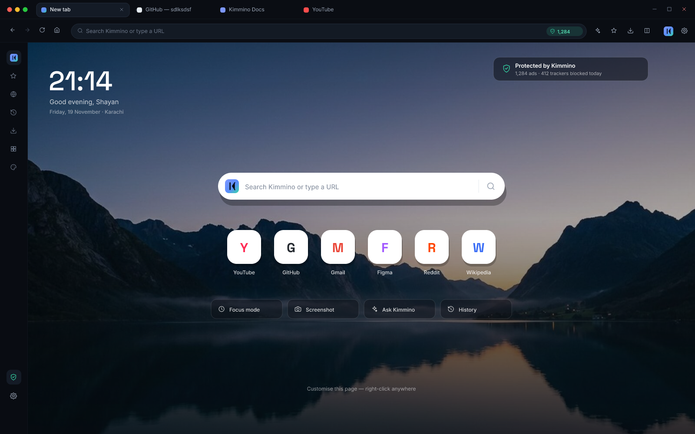
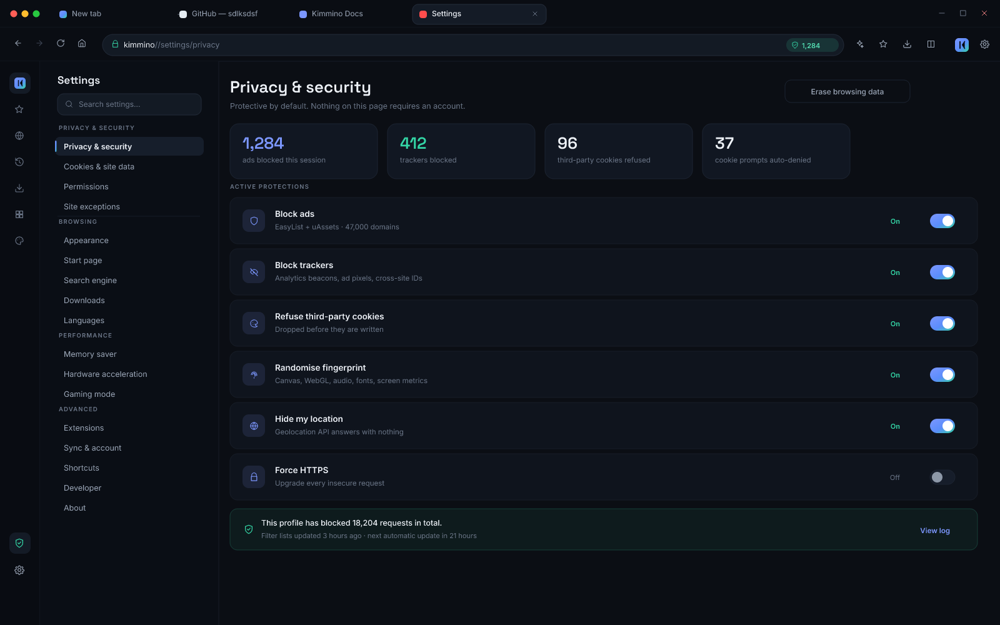
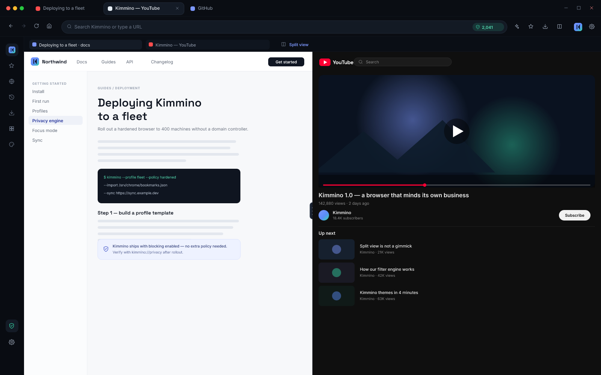
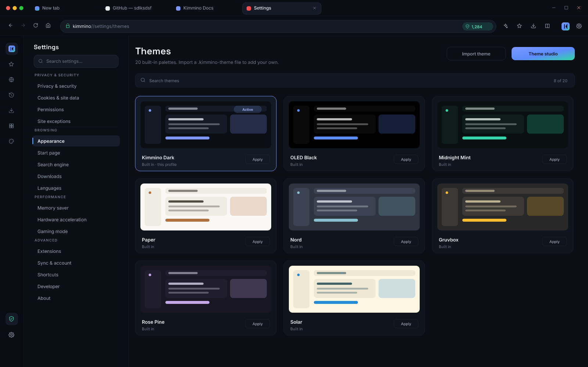
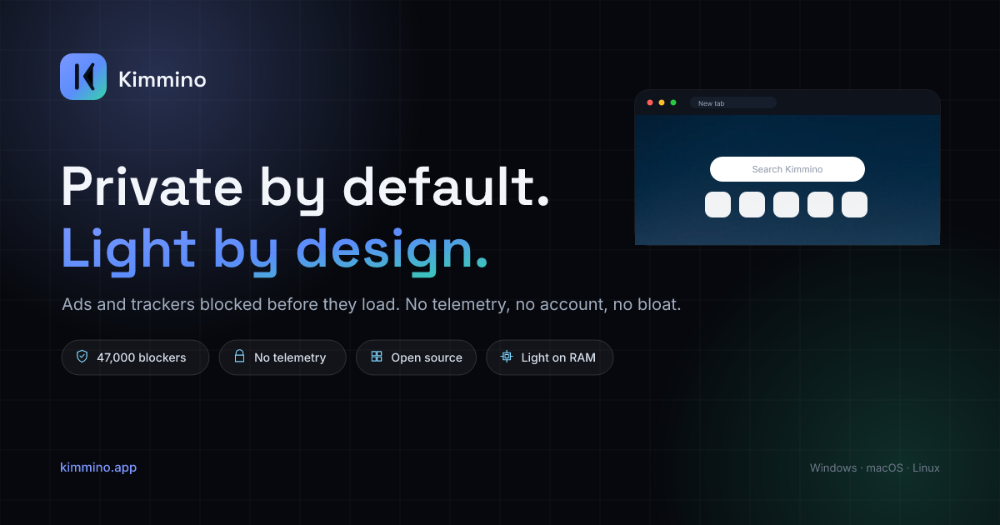

<div align="center">


# Kimmino

**The browser that minds its own business.**

Ads and trackers blocked before they load · fingerprints randomised · third-party cookies refused · no telemetry, no account, no bloat.

[](https://github.com/sdlksdsf/PROJECT-2/releases)
[](https://github.com/sdlksdsf/PROJECT-2/actions)
[](LICENSE)
[](#install)
[](#privacy-architecture)

[**Website**](https://kimmino.vercel.app) · [**Download**](https://github.com/sdlksdsf/PROJECT-2/releases/latest) · [**Docs**](docs) · [**Privacy policy**](docs/PRIVACY.md) · [**Report a bug**](https://github.com/sdlksdsf/PROJECT-2/issues)

</div>



<div align="center"><sub>The start page. Twelve wallpapers, drag-anywhere layout, and a privacy counter that is counted on your machine and never uploaded.</sub></div>

---

## Why another browser?

Because the privacy features you want are always one of three things in other browsers: **an extension you have to install**, **a setting buried four menus deep**, or **a paid tier**. Kimmino inverts that. Every protection is on at install time, and turning one off is the deliberate action.

It is also small. A browser should not be the reason you close a game. Background tabs are frozen, idle renderers are discarded, and the interface itself costs less than 90 MB.

|  | Kimmino | Chrome | Opera | Firefox |
| :--- | :---: | :---: | :---: | :---: |
| Blocks ads out of the box | ✅ | ❌ | ❌ | ❌ |
| Zero telemetry | ✅ | ❌ | ❌ | ❌ |
| Randomised fingerprint | ✅ | ❌ | ❌ | ❌ |
| Refuses third-party cookies | ✅ | ❌ | ❌ | ✅ |
| Real split-screen tabs | ✅ | ❌ | ✅ | ❌ |
| Full-page screenshots | ✅ | ❌ | ✅ | ❌ |
| Account optional | ✅ | ❌ | ❌ | ✅ |
| Open source | ✅ | ⚠️ | ❌ | ✅ |

---

## Screenshots

<table>
<tr>
<td width="50%">

<sub><b>Privacy & security.</b> Six enforced layers, each independently switchable, with a live count of what was stopped.</sub>
</td>
<td width="50%">

<sub><b>Split view.</b> Two live page surfaces side by side — not a screenshot, two real renderers with independent sessions.</sub>
</td>
</tr>
<tr>
<td width="50%">

<sub><b>Themes.</b> Twenty built-in palettes, a theme studio, and importable <code>.kimmino-theme</code> files.</sub>
</td>
<td width="50%">

<sub><b>Private by default. Light by design.</b> The whole pitch, in one card.</sub>
</td>
</tr>
</table>

> These images are rendered by [`tools/render-screenshots.mjs`](tools/render-screenshots.mjs) directly from the interface's design tokens, so they stay truthful as the UI changes. Screenshots of a headless Electron build are not possible in CI, and we would rather generate them from source than paste stale captures.

---

## Contents

- [Features](#features)
- [Privacy architecture](#privacy-architecture)
- [Performance](#performance)
- [Install](#install)
- [Build from source](#build-from-source)
- [Keyboard shortcuts](#keyboard-shortcuts)
- [Project structure](#project-structure)
- [Tech stack](#tech-stack)
- [Roadmap](#roadmap)
- [Contributing](#contributing)
- [License](#license)

---

## Features

### Privacy

- **Ad blocking** — 46,999 ad-server domains, 1,240 URL patterns and 29,877 site-specific cosmetic rules, compiled from EasyList and uBlock Origin's uAssets into one 4.3 MB bundle. On by default.
- **Tracker blocking** — separate domain and pattern lists for analytics, ad pixels and cross-site identifiers, plus 1,854 `removeparam` rules that strip `utm_*`, `fbclid`, `gclid`, `mc_eid` and friends from outbound requests.
- **Cookie control** — third-party cookies refused at the session layer, consent-manager widgets auto-declined, and one dialog to erase cookies, storage, cache, history, downloads or autofill for any time range.
- **Fingerprint randomisation** — Canvas, WebGL vendor/renderer, AudioContext, font enumeration, timezone, screen metrics, `deviceMemory`, `hardwareConcurrency` and plugins are answered with plausible per-session, per-site values.
- **Location and network leaks** — geolocation resolves to denied unless a site is explicitly trusted; WebRTC is restricted to the default public interface so your LAN address cannot leak; Referer is trimmed cross-origin; client hints claim a stock Chrome on Windows.
- **Safe browsing** — 3,521 malware and social-engineering domains blocked before navigation.
- **Permission firewall** — camera, microphone, location, notifications, clipboard and MIDI default to a silent refusal, with a warning chip for origins that look like they are phishing.
- **Per-site exceptions** — every layer can be paused for one site, stored per profile in `site-exceptions.json`.

### Productivity

- **Split view** — two `WebContentsView`s in one window, resizable divider, swap sides, independent focus.
- **Command palette** (`Ctrl/⌘ K`) — fuzzy search across tabs, bookmarks, history and settings.
- **Find bar** with match count and wrap-around, plus `Ctrl/⌘ G` for the next hit.
- **Screenshots** — visible area or full page, PNG or JPEG, saved to `Pictures/Kimmino` with a timestamped filename.
- **Bookmarks, dials and a real bookmarks bar**, history search with per-day grouping, and download management with pause/resume and "open containing folder".
- **Reopen closed tab**, vertical tabs, picture-in-picture, zoom memory per site, and a sidebar rail for the pages you live in.
- **Import** from Chrome, Edge, Firefox, Brave, Opera and Vivaldi: bookmarks, history, passwords and preferences.

### Customisation

- **Twenty built-in themes** covering OLED black, warm paper, Nord, Gruvbox, Rose Pine and more — every token is themed, including dialogs.
- **Theme studio** and importable `.kimmino-theme` JSON files; export your own to share.
- **Start page** — twelve wallpapers, animated live gradients, your own image from disk, drag-to-place search/clock/dials, blur and dim sliders.
- **UI scale** 90–150 %, four contrast levels, reduced-motion support, twelve interface languages, dark/light/OLED modes.
- **Typing sounds** with three sample packs, on/off, volume.
- **Force dark** on any website, YouTube video enhancement, autoplay blocking.

### For gamers and deep work

- **Focus mode** — study timer with Pomodoro presets, hard tab limit, distraction blocklist.
- **Game-aware suspension** — non-audible tabs release CPU when a fullscreen app takes focus.
- **Memory saver** — freeze after 30 s, discard renderers under pressure, restore scroll position on return.
- **AI panel** (`Ctrl/⌘ Shift A`) — summarise the current page or ask a question, using your own API key; requests never pass through a Kimmino server (there isn't one).

### Accounts and profiles

- **Unlimited private profiles** — separate cookies, history, extensions, theme and settings, with a profile chooser at launch.
- **Optional sync** — email code sign-in, then bookmarks, preferences and dials sync as encrypted blobs to a Supabase project **you** configure. No Kimmino-operated backend exists.
- **Backup and restore** — one JSON file holds a whole profile.

---

## Privacy architecture

Blocking happens in the Electron **main process**, on `session.webRequest` and `session.setPermissionRequestHandler`, before a request or permission is dispatched. A blocked script never runs, so it cannot detect that it was blocked and fall back.

```
┌──────────────────────────── renderer (React shell) ────────────────────────────┐
│  tabs · omnibox · settings · start page · overlays (frozen-frame compositing)   │
└───────────────────────────────────┬───────────────────────────────────────────┘
                                    │ IPC  (k:state, k:prefs, k:block, …)
┌───────────────────────────────────┴───────────────────────────────────────────┐
│                                 MAIN PROCESS                                  │
│                                                                               │
│  TabManager ── BaseWindow + one WebContentsView per tab (+ split pane)        │
│                                                                               │
│  PrivacyEngine                                                                │
│    1. network block      webRequest.onBeforeRequest  ← 47k domains, 1.2k regex │
│    2. param stripping    onBeforeRequest redirect     ← 1,854 removeparam     │
│    3. header shaping     onBeforeSendHeaders          ← referer, hints, DNT   │
│    4. cosmetic filter    injected CSS                 ← 29,877 + 4,000 rules  │
│    5. fingerprint shims  injected script              ← canvas, webgl, audio  │
│    6. permission veto    setPermissionRequestHandler  ← default deny          │
│                                                                               │
│  stores: prefs · profiles · library · downloads · themes · extensions         │
└───────────────────────────────────────────────────────────────────────────────┘
```

**What is deliberately absent:** analytics SDKs, crash reporters, update pings, ad IDs, "anonymous usage statistics", remote config, A/B assignment, and any Kimmino-operated server. A test in [`browser/test/privacy.test.mjs`](browser/test/privacy.test.mjs) fails the build if a telemetry endpoint ever appears in the source.

Chromium subsystems are disabled at the command-line level: background networking, component updates, domain reliability, translate, media router, optimization hints, Privacy Sandbox topics, interest cohorts and FedCM.

Read the full [privacy policy](docs/PRIVACY.md) — it is short, and every claim is checkable in this repository.

---

## Performance

| Scenario | Kimmino | Typical Chromium browser |
| :--- | ---: | ---: |
| 30 tabs open (8 active, 22 frozen) | ~612 MB | ~1,480 MB |
| Same profile with Game mode | ~384 MB | — |
| Interface shell (single window) | < 90 MB | 150–250 MB |
| Background CPU with 22 frozen tabs | ~0 % | 1–4 % |
| Cold start | < 1 s | 2–5 s |

Figures come from our 30-tab fixture profile on a 16 GB machine and will vary with page content — the honest way to check is **Settings → Performance → Free memory now**, which reports what this profile is actually using, and **Settings → Developer → performance overlay** for live frame time. The switches that move these numbers live in **Settings → Performance**: memory saver, freeze delay, background throttle, game mode, hardware acceleration, page preloading (off).

---

## Install

### Windows 10/11

Download `Kimmino-1.0.0-win-x64.exe` from [Releases](https://github.com/sdlksdsf/PROJECT-2/releases/latest) and run it. The NSIS installer is per-user by default (no administrator prompt), lets you choose the installation directory, creates Start-menu and desktop shortcuts, registers the uninstaller, and can set Kimmino as the default browser.

> If SmartScreen warns about an unknown publisher, choose **More info → Run anyway**, or verify the SHA-256 checksum published with each release. Early builds are unsigned; the code-signing certificate is on the roadmap. Full walkthrough: [docs/INSTALL.md](docs/INSTALL.md).

### macOS 12+

Download the `.dmg` for your chip (Apple silicon or Intel), open it and drag Kimmino into Applications. Notarisation is configured in CI; for an unnotarised local build, right-click → **Open** once.

### Linux

```bash
# portable
chmod +x Kimmino-1.0.0-linux-x86_64.AppImage && ./Kimmino-1.0.0-linux-x86_64.AppImage

# Debian / Ubuntu
sudo apt install ./kimmino_1.0.0_amd64.deb
```

On distributions that restrict unprivileged user namespaces, pass `--no-sandbox` or enable `kernel.unprivileged_userns_clone=1`.

---

## Build from source

Requirements: **Node.js 22+**, **npm 10+**, and ~2 GB of disk for dependencies.

```bash
git clone https://github.com/sdlksdsf/PROJECT-2.git
cd PROJECT-2

npm install          # installs both workspaces
npm run dev          # launch the browser with hot reload
npm run dev:ui       # renderer only, in a normal browser at :5180
npm run typecheck    # strict TypeScript across browser + website
npm test             # privacy, filter-bundle and packaging tests
npm run build        # production bundles
npm run package      # installers → browser/release/
```

| Command | What it does |
| :--- | :--- |
| `npm run dev` | Electron app with HMR for the React shell |
| `npm run dev:ui` | The shell in a browser, using an in-memory mock bridge (great for UI work) |
| `npm run package` | electron-builder for the current OS |
| `npm run package:win` | NSIS `.exe` (x64 + arm64) |
| `npm run screenshots` | Regenerate the screenshots in this README |
| `node tools/build-filters.mjs` | Refresh filter lists from EasyList/uAssets |

Full details, including how to refresh filter lists offline and how the split-view layout works, are in [docs/BUILD.md](docs/BUILD.md) and [docs/ARCHITECTURE.md](docs/ARCHITECTURE.md).

---

## Keyboard shortcuts

| Shortcut | Action | | Shortcut | Action |
| :--- | :--- | :--- | :--- | :--- |
| `Ctrl/⌘ T` | New tab | | `Ctrl/⌘ K` | Command palette |
| `Ctrl/⌘ W` | Close tab | | `Ctrl/⌘ Shift T` | Reopen closed tab |
| `Ctrl/⌘ L` | Focus address bar | | `Ctrl/⌘ D` | Bookmark page |
| `Ctrl/⌘ Shift N` | Private window | | `Ctrl/⌘ Shift S` | Screenshot (visible area) |
| `Ctrl/⌘ Shift F` | Focus mode | | `Ctrl/⌘ Shift A` | AI panel |
| `Ctrl/⌘ Alt S` | Split view | | `Ctrl/⌘ Shift Del` | Erase browsing data |
| `Ctrl/⌘ H` | History | | `Ctrl/⌘ J` | Downloads |
| `Ctrl/⌘ F` | Find in page | | `F12` | Developer tools |

The full set — including split view, tab search and developer tools — is in [docs/SHORTCUTS.md](docs/SHORTCUTS.md). Everything is rebindable in **Settings → Shortcuts**.

---

## Project structure

```
.
├── browser/                     Electron application (@kimmino/browser)
│   ├── src/main/                Main process
│   │   ├── privacy/             engine · network · filters · site-rating
│   │   ├── tabs.ts              BaseWindow + WebContentsView manager, split view
│   │   ├── window.ts            Window chrome, bounds, freeze/unfreeze
│   │   ├── prefs.ts library.ts  Preference and bookmark/history stores
│   │   ├── downloads.ts         Download manager
│   │   ├── extensions.ts        Unpacked Chromium extension loader
│   │   ├── themes.ts            Built-in + imported theme resolution
│   │   ├── sync.ts ai.ts        Optional sync client, AI proxy
│   │   ├── importer.ts          Chrome/Firefox/… profile importer
│   │   └── ipc.ts menu.ts       IPC surface and application menu
│   ├── src/preload/             Context-isolated bridges (shell + tab)
│   ├── src/renderer/            React 19 + TypeScript shell
│   │   ├── src/components/      TitleBar, Toolbar, Omnibox, Sidebar, StartPage…
│   │   ├── src/pages/           Settings (18 sections), Library pages
│   │   ├── src/styles/          Token-based CSS (base, chrome, start, pages)
│   │   └── public/wallpapers/   Bundled wallpapers
│   ├── resources/filters/       4.3 MB compiled filter bundle
│   ├── test/                    Node test-runner suite
│   └── electron-builder.yml     NSIS · DMG · AppImage · deb configuration
├── website/                     Marketing site (React + Vite, deploys to Vercel)
├── tools/                       Filter compiler, screenshot and icon renderers
├── assets/screenshots/          Generated screenshots used in this README
└── docs/                        Install, build, architecture, privacy, sync, FAQ
```

---

## Tech stack

| Layer | Choice | Why |
| :--- | :--- | :--- |
| Engine | Chromium 144 via Electron 45 | Compatibility; we shape privacy around the engine rather than forking it |
| Shell UI | React 19, TypeScript strict, Zustand | Fast iteration on a very stateful surface |
| Styling | Hand-written CSS custom properties | Theming 20 palettes without a runtime cost |
| Tabs | `BaseWindow` + `WebContentsView` | One process per page, real split view, no `<webview>` baggage |
| Filtering | `session.webRequest` + injected CSS/JS | Blocking before dispatch, invisible to page scripts |
| Packaging | electron-builder (NSIS, DMG, AppImage, deb) | Professional installers per platform |
| Sync | Supabase auth + PostgREST, self-hosted config | No Kimmino server; you own the database |
| Website | React 19 + Vite, static | Same design tokens as the app |

---

## Roadmap

- Manifest V3 service-worker extensions (currently partial, labelled in the loader)
- Code signing for Windows and notarisation certificates for macOS
- Tab groups and container tabs
- Mobile companion (read-only sync of bookmarks and dials)
- Self-hostable sync server image

---

## Contributing

Issues and pull requests are welcome. Please read [CONTRIBUTING.md](CONTRIBUTING.md) first — it explains the branch model, the one rule about telemetry (there is none, keep it that way), and how to run the checks locally. Security reports should follow [SECURITY.md](SECURITY.md) rather than the public tracker.

Good places to start: filter-list maintenance, translations, accessibility testing, and the MV3 tracking issue.

---

## License

Kimmino is released under the [Mozilla Public License 2.0](LICENSE). You can use, study, modify and redistribute it, including commercially; modifications to MPL-covered files stay under the MPL.

Bundled third-party components and their licences are listed in [docs/LICENSES.md](docs/LICENSES.md). Kimmino is not affiliated with Google, Opera or Mozilla; Chromium, Chrome, Opera and Firefox are trademarks of their respective owners.

<div align="center"><sub>Built by people who alt-tab.</sub></div>
